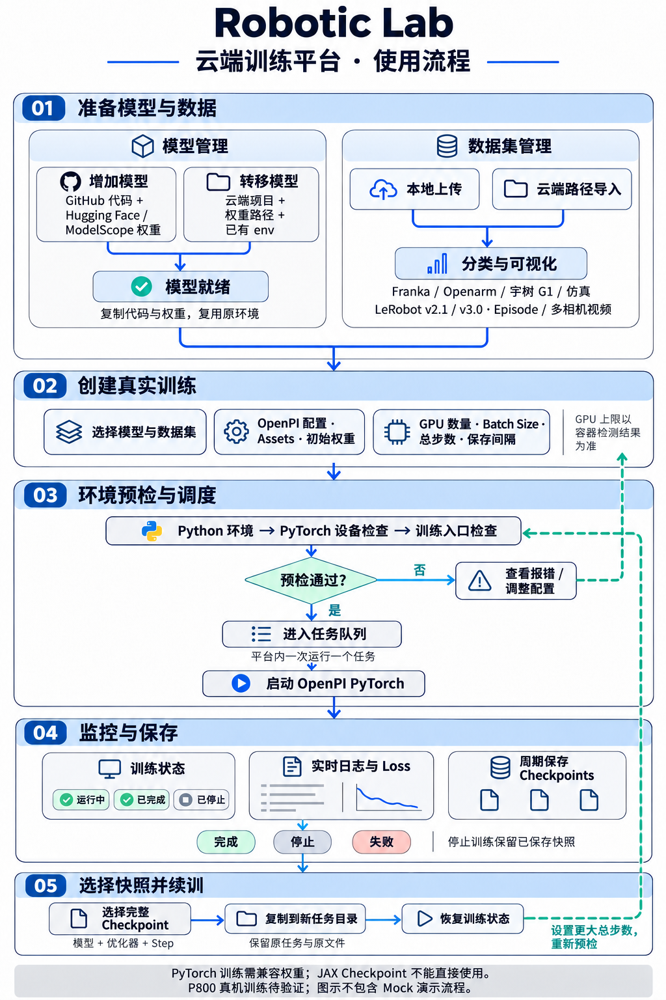

# Robotic Lab 云端训练平台 — 使用流程图

- 范围：1 张使用流程总览
- 语言：中文，保留技术术语
- 风格：paper-figure，竖版 2:3
- 用途：项目汇报
- 生成方式：paper-comic 工作流，内置 imagegen 生成并校正
- 内容依据：本项目已实现功能和本次开发会话，不是外部论文

模型和数据集分别准备，汇合后配置真实训练。环境预检通过后进入队列，启动 OpenPI PyTorch，读取实际日志与 Loss，并周期保存 Checkpoints。预检失败返回调整配置；任务结束后可选择完整快照创建独立续训任务，再次预检和排队。

转移模型时复制代码与权重、复用已有 env；增加模型时下载仓库并按支持的配置流程准备环境。数据可从本机上传或从云端路径复制。当前队列一次运行一个平台任务；停止不保证额外保存快照，续训依赖已有完整快照。

图中 Loss 仅为示意。P800 真机训练尚待验证；JAX Checkpoint 不能直接用于当前 PyTorch 入口。Mock 总览和演示任务不纳入本图。

生成提示词见 [flowchart-prompt.txt](flowchart-prompt.txt)。最终校正：增加模型标签、删除暂停状态、续训回路返回环境预检。
